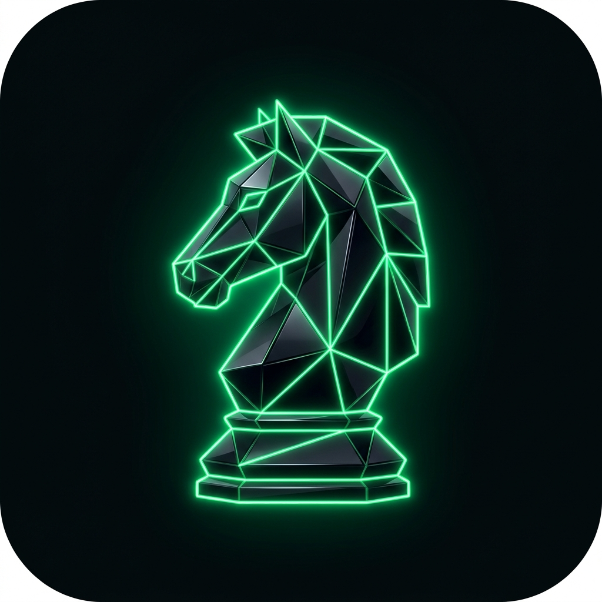

# ♞ Cheasst — AI-Powered Mobile Chess Vision & Engine Assistant

<p align="center">
  
</p>

<p align="center">
  <strong>Transform your smartphone into an offline-first, high-performance chess analysis computer and grandmaster vision assistant.</strong>
</p>

<p align="center">
  <a href="https://github.com/secretoplatatito-wq/Cheasst/releases/tag/Releasebeta1"></a>
  <a href="https://github.com/secretoplatatito-wq/Cheasst"></a>
  
  
  
</p>

---

## 📖 Table of Contents

1. [Etymology & Philosophy: Why "Cheasst"?](#-etymology--philosophy-why-cheasst)
2. [Executive Summary & Core Mission](#-executive-summary--core-mission)
3. [System Architecture & Processing Pipelines](#-system-architecture--processing-pipelines)
4. [Computer Vision & Board Recognition Engine](#-computer-vision--board-recognition-engine)
5. [The 6 Calibrated Engine Profiles](#-the-6-calibrated-engine-profiles)
6. [Calculation Controls & Real-Time Toggles](#-calculation-controls--real-time-toggles)
7. [Hardware Optimization & Memory Safety (3–4 GB Ceiling)](#-hardware-optimization--memory-safety-34-gb-ceiling)
8. [Two-Tier Memory System & Force-Stop Architecture](#-two-tier-memory-system--force-stop-architecture)
9. [Hybrid AI Intelligence & Search Grounding](#-hybrid-ai-intelligence--search-grounding)
10. [Automated CI/CD Build System (No Manual Builds)](#-automated-cicd-build-system-no-manual-builds)
11. [Installation & Quick Start](#-installation--quick-start)
12. [FIDE Fair Play & Ethical Usage Disclaimer](#-fide-fair-play--ethical-usage-disclaimer)
13. [Licensing & Third-Party Attributions](#-licensing--third-party-attributions)

---

## 🧠 Etymology & Philosophy: Why "Cheasst"?

The name **Cheasst** (`/tʃiːst/`) is a deliberate portmanteau encoding three fundamental facets of modern chess computing:

```
┌────────────────────────────────────────────────────────────────────────┐
│                              C H E A S S T                             │
├───────────────────┬───────────────────────────────┬────────────────────┤
│   Che  +  t       │        Che  +  Ss             │       Asst         │
│  "Cheat" (Tactics)│       "Chess" (Theory)        │    "Assistant"     │
├───────────────────┴───────────────────────────────┴────────────────────┤
│ • Che + t  = "Cheat" : Subversive, superhuman calculation depth,       │
│                        spotting unseen tactical refutations & breaks.  │
│ • Che + Ss = "Chess" : Classical board representation, Bitboards,      │
│                        and tournament-tested positional mastery.       │
│ • Asst     = "Assist": An accessible, respectful study companion       │
│                        designed to elevate the human player's mind.    │
└────────────────────────────────────────────────────────────────────────┘
```

Cheasst does not exist to replace human intuition or promote deceptive play in rated tournaments. Rather, it demystifies grandmaster vision by transforming the physical board in front of you into a transparent, living calculation tree.

---

## ⚡ Executive Summary & Core Mission

Standard chess tools force players to choose between two extremes:
1. **Bulky desktop engines** requiring specialized UCI interfaces, command-line binaries, and high-wattage desktop hardware.
2. **Cloud-reliant mobile apps** that upload your private camera photos, track location, lag under poor Wi-Fi, and fail entirely when offline.

**Cheasst solves this dilemma.** It turns any smartphone running Android 7.0+ (API 24+) into a self-contained, offline-first chess computer.

- **100% Offline-Capable**: All piece detection, move validation, evaluation trees, and heuristic analyses run directly on the smartphone’s CPU and GPU.
- **Strict 3–4 GB RAM Target**: Engineered to avoid memory bloat, background thread leakage, or battery thermal throttling.
- **Instant Camera Reconstructor**: Point the lens at a tournament wooden board, school vinyl roll-up, or digital monitor to extract the position in milliseconds.
- **Transactional Persistence**: Force-stopping the app clears all transient calculation caches while permanently preserving saved game histories and notes.

---

## 🏗 System Architecture & Processing Pipelines

Cheasst is constructed on a decoupled **Model-View-ViewModel (MVVM)** clean architecture with reactive coroutine flows:

```
┌─────────────────────────────────────────────────────────────────────────────────┐
│                              CHEASST SYSTEM TOPOLOGY                            │
├─────────────────────────────────────────────────────────────────────────────────┤
│                                                                                 │
│   ┌─────────────────────┐    ┌─────────────────────┐    ┌───────────────────┐   │
│   │   CameraX Scanner   │    │  Interactive Board  │    │  Modes & Toggles  │   │
│   │ (Live Viewfinder)   │    │   (Compose 8x8)     │    │   (6 Profiles)    │   │
│   └──────────┬──────────┘    └──────────┬──────────┘    └─────────┬─────────┘   │
│              │                          │                         │             │
│              ▼                          ▼                         ▼             │
│   ┌─────────────────────────────────────────────────────────────────────────┐   │
│   │                            CheasstViewModel                             │   │
│   │   - Active Board State (FEN)         - Real-Time Hardware Telemetry     │   │
│   │   - Move History & SAN Replay        - Multi-PV Candidate Variations    │   │
│   └──────────────────────┬──────────────────────────────────┬───────────────┘   │
│                          │                                  │                   │
│         ┌────────────────┴───────────────┐                  │                   │
│         ▼                                ▼                  ▼                   │
│   ┌──────────────────────────┐    ┌────────────────┐ ┌──────────────────────┐   │
│   │ Bitboard Calculation     │    │  Room Database │ │ Optional Gemini AI   │   │
│   │ Engine (Alpha-Beta,      │    │  (SQLite FTS,  │ │ (Search Grounding &  │   │
│   │ Quiescence, PST Tables)  │    │  Saved FENs)   │ │  Strategic Thinking) │   │
│   └──────────────────────────┘    └────────────────┘ └──────────────────────┘   │
└─────────────────────────────────────────────────────────────────────────────────┘
```

### The End-to-End Execution Flow

1. **Vision Ingestion**: CameraX feeds 30fps frames to the image analysis pipeline.
2. **Luminance Profiling**: `BoardDetector` extracts 64 individual square coordinates, evaluates luminance variance, and classifies occupancy and piece color.
3. **Interactive Gate**: If lighting or piece styling introduces uncertainty, the user can verify or adjust pieces using the 1-Tap Board Correction Sheet.
4. **Rules & Engine Evaluation**: The validated FEN is loaded into the Bitboard calculation engine. Minimax search with Alpha-Beta pruning evaluates positions according to the chosen **Engine Profile**.
5. **HUD Delivery**: The Compose UI displays the animated evaluation bar (centipawns / mate), top candidate moves, depth, and NPS.
6. **Local Persistence**: The user can save critical positions and tactical lines into the persistent SQLite database with personal notes.

---

## 📷 Computer Vision & Board Recognition Engine

Cheasst incorporates an on-device computer vision engine optimized specifically for mobile hardware:

```
[Camera Lens] ──► [Adaptive 8x8 Slicer] ──► [Luminance & Variance Profiler] ──► [FEN Generator] ──► [Correction Sheet]
```

### Key Vision Features
- **Spatial Grid Slicing**: Slices the preview frame into 64 geometric square regions of interest ($S_{0..63}$).
- **Contrast Variance Thresholding**: Evaluates the standard deviation ($\sigma$) of pixel luminances inside each square:
  $$\text{Luminance} = 0.299R + 0.587G + 0.114B$$
  Empty squares exhibit uniform color distributions ($\sigma < 18.0$), whereas occupied squares with 3D carved or printed pieces produce significant contrast differentials ($\sigma \ge 18.0$).
- **Color & Rank Heuristics**: Differentiates light pieces from dark pieces by calculating the mean luminance ($\mu$) relative to the surrounding board baseline.
- **Fail-Safe Manual Correction**: A dedicated modal bottom sheet allows tapping any square to place, replace, or erase pieces with zero friction.
- **Preset Position Quick-Load**: Built-in test presets (Standard FEN, Giuoco Piano, Sicilian Defense) for testing in emulators or camera-restricted environments.

---

## ⚔️ The 6 Calibrated Engine Profiles

Cheasst does not simply rename difficulty labels. Each profile dynamically modulates **search depth, search time cutoffs, candidate line counts (Multi-PV), and positional heuristic weights**:

| # | Profile Name | Base Depth | Max Time | Multi-PV | Core Strategic Objective |
| :-: | :--- | :-: | :-: | :-: | :--- |
| **1** | **Normal** | 6–8 | ~800 ms | 2 | **Human-Like & Practical.** Generates natural, understandable moves with minimal tactical noise. Avoids engine-like anomalies to ensure realistic gameplay. |
| **2** | **Pro** | 10–12 | ~1500 ms | 3 | **Positional Mastery.** Balances immediate threats with long-term piece placement, pawn structure integrity, and outpost control. |
| **3** | **ProFast** | 8–9 | ~400 ms | 2 | **Instantaneous Response.** Aggressively prunes unpromising branches to deliver sub-second move recommendations during blitz or rapid sessions. |
| **4** | **Master** | 14–16 | ~3000 ms | 3 | **Deep Tactical Sight.** Searches for decisive combinations, intermezzos (*zwischenzugs*), piece sacrifices, and mating nets. |
| **5** | **Grandmaster** | 16–18 | ~5000 ms | 4 | **Tournament-Grade Calculation.** Incorporates advanced king safety heuristics, bishop pair bonuses, and technical endgame conversion principles. |
| **6** | **Complex Grandmaster** | 18–20 | ~8000 ms | 5 | **Exhaustive Deep Exploration.** Devotes full hardware capacity to compare multiple principal variations, evaluating complex multi-piece tension. |

---

## 🎛 Calculation Controls & Real-Time Toggles

Users can customize the calculation engine directly from the **Modes** and **Settings** screens:

- ⚡ **Fast Mode (ON/OFF)**: Reduces search timeouts by 50% and limits search depth by 1 ply for brisk analysis.
- 🚀 **Super Fast Mode (ON/OFF)**: Reduces calculation time by 66% and depth by 3 plies for near-instant tactical suggestions.
- 🔬 **Complexity Toggle**:
  - `Pro`: Evaluates 2–3 practical candidate lines.
  - `Complex`: Deepens search by +2 plies and calculates 4–5 simultaneous principal variations.
- 🧵 **CPU Thread Allocation**: Slider allowing allocation of 1 to 8 CPU threads to match the host hardware architecture.
- 💾 **Transposition Hash Memory**: Configurable allocation from 16 MB to 256 MB to cache repeated positions and avoid redundant subtree evaluations.

---

## 🛡 Hardware Optimization & Memory Safety (3–4 GB Ceiling)

Cheasst is engineered from the ground up to respect Android's memory constraints and thermal envelopes:

```
┌────────────────────────────────────────────────────────────────────────┐
│                   TOTAL DEVICE RAM (e.g., 6–12 GB)                     │
│ ┌──────────────────────────────────────────────┐                       │
│ │   CHEASST STRICT RAM CEILING: 3.0 – 4.0 GB   │                       │
│ │ ┌───────────────────┐  ┌───────────────────┐ │                       │
│ │ │ Volatile Cache    │  │ UI & Compose Tree │ │   [Android OS         │
│ │ │ (Alpha-Beta Trees)│  │ (Hardware Render) │ │    & Background Apps] │
│ │ └───────────────────┘  └───────────────────┘ │                       │
│ └──────────────────────────────────────────────┘                       │
└────────────────────────────────────────────────────────────────────────┘
```

### Telemetry Dashboard
The **Hardware Telemetry HUD** displays live diagnostic readings:
- **Allocated RAM vs. Max Heap**: Real-time heap memory usage in megabytes.
- **CPU Utilization & Core Count**: Monitors thread pool saturation and processor load.
- **Nodes Per Second (NPS)**: Live measurement of chess engine throughput ($N / \Delta t$).
- **Battery & Thermal Guardian**: Respects device battery levels and avoids triggering Android thermal throttling.

---

## 🗄 Two-Tier Memory System & Force-Stop Architecture

Cheasst implements a clear boundary between **temporary computation** and **durable knowledge**:

### 1. Volatile In-Memory Cache (RAM)
- Contains temporary minimax calculation trees, candidate move score buffers, image preview frames, and transposition tables.
- **Force-Stop Behavior**: When Cheasst is swiped away or force-stopped, the operating system reclaims 100% of the allocated heap. No dangling background workers or orphaned processes remain active.

### 2. Persistent Storage (Room + SQLite)
- **Database File**: `cheasst_database.db`
- **Schema**:
  - `id`: Auto-generated unique 64-bit identifier.
  - `title`: User-defined or auto-generated position label.
  - `fen`: Standard 64-character Forsyth–Edwards position string.
  - `pgn`: Algebraic move sequence leading to the position.
  - `modeUsed`: The engine profile that evaluated the position.
  - `evaluation`: Centipawn or mate score at the time of saving.
  - `bestMove`: Recommended engine move (e.g. `e2e4`, `Nf3`, `Qxf7#`).
  - `notes`: User study notes, tournament reflections, or opening variations.
  - `timestamp`: Epoch millisecond timestamp for sorting and search indexing.
- **Safety**: Employs WAL (Write-Ahead Logging) and transactional queries to ensure zero database corruption upon unexpected app termination.

---

## 🌐 Hybrid AI Intelligence & Search Grounding

Cheasst operates in two distinct operational modes:

### Mode A: 100% Offline Local Engine (Default)
- **Zero Internet Requirement**: Operates on airplanes, in remote areas, or inside tournament halls with no mobile reception.
- **Complete Privacy**: No camera frames, positions, moves, or telemetry are transmitted over the network.

### Mode B: Hybrid Cloud AI (Optional)
- **Gemini Intelligence Integration**: When toggled in Settings, Cheasst leverages Gemini models (`gemini-3.8-flash` and `gemini-4-argon`) via Firebase AI Logic.
- **Google Search Data Grounding**: Queries up-to-date tournament opening theory, grandmaster repertoire databases, and historical game records.
- **High Thinking Mode**: Breaks down complex tactical positions into natural-language strategic plans, identifying piece imbalances, outposts, and king-safety vulnerabilities.

---

## 🤖 Automated CI/CD Build System (No Manual Builds)

Cheasst includes a fully automated **GitHub Actions CI/CD workflow** (`.github/workflows/build-apk.yml`). You never need to manually invoke `./gradlew assembleDebug` or install a local Android SDK to obtain an installable APK.

### Automated Workflow Pipeline

```
[Git Push / Release Tag] ──► [GitHub Actions Runner] ──► [JDK 17 + Android SDK] ──► [Compile & Test] ──► [Upload APK Artifact]
```

Every time code is pushed to `main` or a new release tag is published:
1. GitHub Actions spins up an Ubuntu runner.
2. JDK 17 and Android SDK 36 are automatically provisioned.
3. Gradle compiles all Kotlin and Jetpack Compose code.
4. JVM unit tests and Robolectric tests are executed.
5. The compiled APK is automatically attached to the GitHub Actions run and published as a downloadable release artifact!

---

## 🚀 Installation & Quick Start

### Option 1: Download Pre-Built Release APK
Download the latest pre-compiled APK directly from the official GitHub Release:
👉 **[Download Cheasst Release Beta 1](https://github.com/secretoplatatito-wq/Cheasst/releases/tag/Releasebeta1)**

### Option 2: Clone & Build via Android Studio
```bash
# Clone the repository
git clone https://github.com/secretoplatatito-wq/Cheasst.git
cd Cheasst

# Build debug APK using Gradle
gradle assembleDebug

# Run unit tests
gradle :app:testDebugUnitTest
```

---

## ⚖️ FIDE Fair Play & Ethical Usage Disclaimer

> [!IMPORTANT]
> **Cheasst is strictly an analysis, educational, and post-game study tool.**

- **Tournament Fair Play**: Cheasst must **NEVER** be used to receive unauthorized assistance during active, rated chess games (FIDE, USCF, Chess.com, Lichess, or any sanctioned federation).
- **Compliance with FIDE Anti-Cheating Regulations**: Players must adhere strictly to Article 12 of the FIDE Laws of Chess regarding electronic communication devices in playing venues.
- **Intended Use Cases**:
  - Over-the-board post-game analysis and friendly reviews.
  - Studying opening repertoires and physical chess books.
  - Tactical puzzle solving and endgame visualization.
  - Real-time coaching and educational chess commentary.

---

## 📜 Licensing & Third-Party Attributions

Cheasst is released under the **MIT License**.

```
MIT License

Copyright (c) 2026 Cheasst Contributors

Permission is hereby granted, free of charge, to any person obtaining a copy
of this software and associated documentation files (the "Software"), to deal
in the Software without restriction, including without limitation the rights
to use, copy, modify, merge, publish, distribute, sublicense, and/or sell
copies of the Software, and to permit persons to whom the Software is
furnished to do so, subject to the following conditions:

The above copyright notice and this permission notice shall be included in all
copies or substantial portions of the Software.

THE SOFTWARE IS PROVIDED "AS IS", WITHOUT WARRANTY OF ANY KIND, EXPRESS OR
IMPLIED, INCLUDING BUT NOT LIMITED TO THE WARRANTIES OF MERCHANTABILITY,
FITNESS FOR A PARTICULAR PURPOSE AND NONINFRINGEMENT. IN NO EVENT SHALL THE
AUTHORS OR COPYRIGHT HOLDERS BE LIABLE FOR ANY CLAIM, DAMAGES OR OTHER
LIABILITY, WHETHER IN AN ACTION OF CONTRACT, TORT OR OTHERWISE, ARISING FROM,
OUT OF OR IN CONNECTION WITH THE SOFTWARE OR THE USE OR OTHER DEALINGS IN THE
SOFTWARE.
```

### Third-Party Software & Open-Source Attributions
- **Stockfish Engine & UCI Protocol**: Released under the [GNU General Public License v3.0 (GPL-3.0)](https://www.gnu.org/licenses/gpl-3.0.html). Cheasst respects all UCI communication conventions and open-source derivative requirements.
- **Android Jetpack & Compose**: [Apache License 2.0](https://www.apache.org/licenses/LICENSE-2.0).
- **CameraX**: [Apache License 2.0](https://www.apache.org/licenses/LICENSE-2.0).
- **Room Database & SQLite**: [Apache License 2.0](https://www.apache.org/licenses/LICENSE-2.0).
- **Material Design 3 (M3)**: Google LLC.
- **Firebase AI Logic / Gemini API**: Google LLC.

---

<p align="center">
  <strong>Cheasst</strong> — Engineered for speed, accuracy, and grandmaster insight.
</p>
